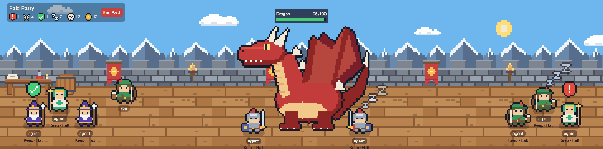

# herdr-vis

[](https://github.com/thanoslabs/herdr-vis/releases/latest)
[](https://github.com/thanoslabs/herdr-vis/pulls?q=is%3Apr+author%3Aapp%2Frenovate)
[](LICENSE)

Agent workspace visualizers for the [Herdr](https://herdr.dev) desktop app: layouts that show your coding agents as something more fun than a list.

## Idle RPG

Turn your agents into a raid party. Collect loot and upgrades as you progress.



*The day and night are sped up here: a full cycle takes 20 minutes, not 18 seconds.*

A pixel-art castle rampart across the top of the window, under a sky with drifting clouds and a 20-minute day and night. At night the rampart goes dim, lit by pools of torchlight. You and every agent are pixel-art adventurers: a wizard, healer, warrior or archer, picked at random on arrival.

| Agent status | What the adventurer does |
|---|---|
| Working | Bounces under two clashing swords |
| Blocked (needs you) | A hopping red "!" bubble |
| Done | A green tick bubble |
| Idle | Rests while z's drift up |

- **Click the floor** to walk there.
- **Click an agent** for a card with its portrait, status, location and a "Go to terminal" button. The wrench on the portrait lets you pick a different class; click yourself to change your own.
- **Drag an agent** to carry it around; release to drop it. Positions and classes are remembered.
- **Battle mode** (the Start Raid / End Raid button by the sign, on by default): a random monster (slime, ogre or dragon) stands in the middle with 100 HP and the party forms up around it, warriors up close and the rest at range. Every 3 seconds each working agent attacks for 1 HP, each a moment apart, the point coming off as the blow lands, with its own animation: the warrior swings its sword, the archer draws and shoots, the wizard thrusts its staff and throws a fireball, and the healer lobs a potion that splashes. You join in whenever the party is attacking; as a warrior you have to stand next to the monster to reach it. The monsters are alive too: they blink, the slime squashes and rises, the dragon breathes and sways its tail, and the ogre roars now and then. When the monster falls, another one turns up, and the sign counts the kill and the gold it dropped (1 gold per 100 HP). Turning battle mode off sends everyone back to their own spots.
- **Experience and levels:** progress belongs to you and to the four classes, never to an agent. Every point of damage that lands earns experience for the attacker's class and for you, who lead the raid. Each class levels on its own, and so do you; a gold note pops up over the head of whoever levels up. Your card shows your level, and every card the level of that character's class, with progress to the next, and the class picker shows every class's level. Levels unlock nothing yet.
- **The sign and the codex:** the sign counts your agents by status with pixel icons (crossed swords for working, a "Zz" for resting), then a skull with the monsters slain and a coin with your gold: 1 gold for every 100 HP of a monster, paid when it falls. Click the skull to open the codex, which lists how many of each kind you have slain; a kind you have not beaten yet shows as "???".

Full description of the design and how it is built: [`idle-rpg/RECIPE.md`](idle-rpg/RECIPE.md).

## Install

Each visualizer is a folder laid out like Herdr's config folder (`~/.config/herdr-app`): `layouts/`, `mods/`, `themes/`.

Clone the repo and copy the layout into Herdr:

```sh
git clone https://github.com/thanoslabs/herdr-vis.git
cd herdr-vis
./install.sh idle-rpg
herdr-app do layout.switch --name idle-rpg
```

`install.sh` copies the layout, theme and mod into `~/.config/herdr-app` (or `$HERDR_APP_HOME`), which is how Herdr expects layouts to be added. Run it again after a `git pull` to update. To remove the layout, delete `layouts/idle-rpg.json`, `layouts/idle-rpg.svg`, `themes/idle-rpg.json` and `mods/idle-rpg/` from that folder; your other layouts are untouched.

Alternatively, ask your agent inside Herdr to read `~/.config/herdr-app/AGENTS.md` and add the layout from this repo's `idle-rpg` folder.

## Developing

- Edit the files in this repo, then run `./install.sh idle-rpg` to copy them into Herdr. Herdr reloads layouts and mods as they change; if a mod edit does not show, switch layouts away and back.
- Run `herdr-app check idle-rpg/mods/idle-rpg` after every mod change, and `herdr-app status` to see errors.
- All the pixel art is generated: edit the grids in `tools/idle-rpg-sprites.py` and run `python3 tools/idle-rpg-sprites.py idle-rpg/mods/idle-rpg/art`.
- Herdr writes `gpui-kit.d.ts` and `jsconfig.json` into each mod folder; they are git-ignored.
- See [CONTRIBUTING.md](CONTRIBUTING.md) for branch, commit and release conventions.

## Layout

```
.
├── install.sh       # copies a visualizer into ~/.config/herdr-app
├── tools/           # idle-rpg-sprites.py: draws every PNG in art/
├── idle-rpg/
│   ├── layouts/     # idle-rpg.json (the window), idle-rpg.svg (settings preview)
│   ├── mods/        # idle-rpg/ (main.js, rules.js, mod.json, art/)
│   ├── themes/      # idle-rpg.json
│   ├── RECIPE.md    # the brief the layout is built from
│   └── preview.png
└── .github/         # CI, release and Renovate workflows
```

## License

[MIT](LICENSE)
