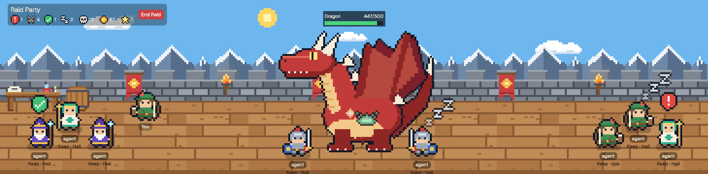
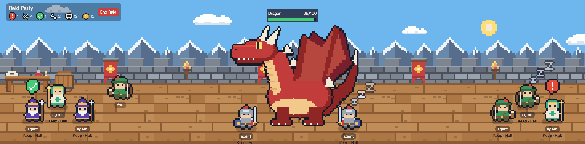

# Idle RPG

Turn your agents into a raid party. Collect loot and upgrades as you progress.

A castle rampart across the top of the window, in pixel art, staffed by a small adventuring party. You and every agent are stubby, dark-outlined characters in one of four classes (wizard, healer, warrior, archer), and what each agent's character is doing shows that agent's status. Behind the battlements the sky runs a full day and night every 20 minutes, with drifting clouds. Below it are the tabs and terminals; the standard Spaces and Agents sidebar is on the left.

*The day and night are sped up in this recording: a full cycle takes 20 minutes, not 18 seconds.*

## What you see

- **Sidebar (left, 268px):** Herdr's own sidebar, unchanged: brand bar, Spaces, Agents, footer.
- **Scene (top of the rest, one third of the height, 230 to 560px):** a pixel-art scene at 4 screen pixels per art pixel. Back to front: a sky of night blue `#0b1230` with a tiled star field, a day-blue layer `#6db6ee` and five orange `#f2924e` horizon bands, each faded in and out by the time of day; a sun and a moon riding one circle half a turn apart and setting behind the wall; four clouds drifting left to right at 6 to 12 px/s, dimmer at night; a tiled snowy mountain range; 64px grey stone battlements with red banners and torches whose glow flickers and brightens at night; a 152px floor of tiled wooden planks with a table (scroll, potion, candle) and a barrel at the left. At night a dark tint lies over the sky (half strength), and darkness (`#0a1030`) lies over the wall, the floor and everyone on it, under the cards. Each torch keeps a pool of light clear around its flame and the candle a small one on the table; the dark deepens away from a flame in six even steps (rings, not a blur) to half strength, so the far corners are dim, never black, and above the wall it thins out over 80px so a tall monster is not cut in two. It is a row of pictures (in `art/light/`) that fades in with the night: `candle` (272px, the left end), one `torch` (384px, flame in the middle) per torch, and `fill` stretched over what is left. Between raids the campfire (below) has a pool of its own, wider and lower than a torch's, centred on the heart of its flames: its 320px picture, `fire-<i>`, is cut into the row over the fire, the pictures it overlaps clipped short on either side (an `overflow_hidden` box over each), so every pixel is darkened exactly once. The torches' pools reach under the fire, so that picture carries their light as well as the fire's (where pools overlap, the lighter wins); the fire stands in 16px steps along the torches' 384px pictures, so there is one per step, 24 in all, and `i` is the fire's step along a torch's picture. The fire's pool is wholly dark by that picture's edges (the generator asserts it), so it meets its neighbours without a seam, and the edges never reach the light of a torch past the last one drawn. A dark pill top-left reads "Raid Party" over a row of counts, each a small pixel icon (7×7 art pixels plus the outline, shown at 2 screen px a pixel, 18px) and a number ("nobody in yet" while there are no agents). In battle mode, once anything has been slain or earned, a skull with the kill total and a gold coin with the gold. Clicking the skull count opens the codex (below); clicking the gold opens the shop (below). Both are chips that highlight on hover and stay highlighted while their panel is open. Once any class has earned a skill point, a gold star follows with the skill points left to spend across all four classes: the number in gold `#ffd166` on a faint gold chip while there are any, the whole chip dimmed to 55% when there are none. Clicking it opens the skills panel (below). **Top-right corner:** a strip like the sign's (`#00000050`, radius 6, 36px high, 10px in from the right edge, at y 8; under the sign at y 54 when the scene is narrower than 640px, where there is no room beside it) holds the agents' statuses and the settings gear. It is drawn on the floor layer after the night's darkness and before the cards, so it keeps its colours at night (the sign itself is under the darkness where the scene is low enough for it to reach). One icon per status with any agents, in this order: a red alert for agents that need you, crossed swords for working, a green tick for done, a "Zz" for resting, each the sign icon at 3 screen px a pixel (27px wide), with the count on a badge at its bottom-right corner, 4px past the corner, in the pixel font (white, 2 screen px a pixel; "99+" past 99) and a tooltip ("Resting: 2"). A status with no agents has no icon. Last, always there, a grey pixel gear (30px) that opens the settings menu, highlighting on hover and while open like the sign's chips.
- **You (72×72):** one of the four classes, picked at random the first time and remembered, labelled "You".
- **Looks:** every character wears the colourway and the hat its class has equipped in the shop (the default colourway and no hat until one is bought and put on), everywhere a class sprite is drawn: standing, walking, dangling, the fighting poses, a card's portrait, the class picker, the skills panel's tabs and the shop's own tabs and previews. A hat is a second picture laid over the sprite at the same size and place (`sprite()` in `main.js`, the one place that stacks them); with no hat on there is no second picture. A card's portrait shows the sprite 6px lower while a hat is on, so a hat's top is not cut off.
- **Agents (72×72):** one per agent, each a class picked at random when the agent first appears and remembered for that terminal. Each stands on a soft shadow with its name underneath, which is where it works ("space · tab") on a dark translucent pill, and a status bubble by its head.
- **Tab bar (42px) and terminals:** Herdr's `tabs` mod, then the active tab with each pane as a card (radius 10, 1px border, `pane` header 30px).
- **Theme `idle-rpg`:** dark navy terminals (`#101c2c` on `#dbe7f3`), accent `#5cc8ff`.

## How it behaves

- **working:** the character bounces, and two pixel swords over its head swing together and apart with a spark flashing as they meet (native `loop` on `left` and `opacity`, 520ms).
- **blocked:** a red pixel speech bubble with a white "!" that hops (native `loop` on `top`).
- **done:** a green pixel speech bubble with a white tick, still.
- **idle:** the character stands still while three pixel z's of growing size drift up beside its head and take turns fading (native loops, 2.4s).
- The focused agent's shadow, and the one whose card is open, has a pale yellow ring.
- **Click empty space:** you walk there (4ms per px, clamped to the floor), alternating two walk frames every 160ms: a one-pixel lean each way with the other foot tucked up.
- **Click an agent:** a card opens above it, or beside it when there is no room: a 56px portrait (the sprite at 6px a pixel, cropped to the head), the same "space · tab" name as its title, the kind of agent (program name), status and for how long, terminal title, a "Go to terminal" button (`agent.focus`) and a close button. Under the portrait, one 10px line for the agent's class: the class name, "Lv n" in gold `#ffd166`, a 5px gold bar filling with the way to the next level, "into/need" experience, and, when the class has skill points to spend, the gold star and their number. The line highlights on hover; clicking it opens the skills panel on that class and closes the card. A small wrench in the portrait's top-right corner toggles a row of the four classes (the current one ringed), each with its own "Lv n" under the sprite; picking one changes the sprite, saves it and hides the row. Clicking the agent again closes the card.
- **Click yourself:** a smaller card with your portrait, class name and the same wrench, and two level lines: "You" (your own level) above your class's.
- **Drag an agent:** after 4px of movement it becomes a dangling sprite that leans against the direction of travel. Releasing drops it; released over the wall, it falls to the floor.
- **Stations:** on the non-raid screen only (battle mode off) three things stand at the back of the floor, each opening one of the panels the sign's chips open during a raid, and closing it when clicked again: the **codex** is a purple book lying on the table (the whole table is the target); the **skills** are a straw training dummy with a target on its chest (48×72, left 204), whose label reads "Skills +N" while N points are waiting to be spent; the **shop** is a merchant's stall with a red and cream striped awning and goods on its counter (104×84, left 304). Each has its name under it on the same dark pill as an agent's, and a press on one does not reach the floor. Under the pointer a station shows it can be used: its picture (`stations/<name>/idle`) swapped for its `hot` twin, the same picture inside a one-pixel white outline (4px on screen; for the codex, both the table and the book), hopping up 4px (120ms; for the codex only the book hops), a white arrow (`stations/arrow`, 28×20) bobbing 8px over it, its name in white on a darker pill, and a pointer cursor. It has to show in broad daylight as well as at night, in the scene's own pixel style rather than a coloured frame. They are props, drawn before the characters and dimmed with them at night, and are not drawn during a raid, when the formation needs the floor.
- **Campfire:** on the non-raid screen only, a campfire burns in the middle of the floor: a ring of grey stones (lit from the top left, each in its own outline), four crossed logs with bark, pale sawn ends and charred tops, a bed of embers and tall flames in the torch's colours, deep orange out to a near-white core (216×180, 52×43 art px plus the outline's margin; its feet at floor y 100, a third of the way up the floor). It is the middle of the scene to the nearest 16px, but never left of x 528 (its middle), which keeps it 8px clear of the shop's stall outlined under the pointer and, at 640px, inside the right edge; below 640px wide it is not drawn. It is scenery: no hover, no cursor, and a press on it walks you there like one on the floor, except that a press anywhere across it (within 116px of its middle) short of floor y 112 stops you there, just in front of the stones; a newcomer's default spot is never there either. It is drawn among the characters by depth (its y is its feet's), so whoever stands in front of it is drawn over it and whoever stands behind it under it. It flickers with native loops only, never a timer or a re-render: `campfire/base` (the stones, logs and the low heart of the flames, which never changes) with four taller flames (`campfire/flame-1` to `-4`) laid over it, each fading in and out on its own period (520, 740, 380 and 610ms), four one-pixel sparks drifting over it as they fade in and out, and behind it a warm glow like a torch's (216×144, `#ffb34750`, flickering, 25% by day and full at night). At night it lights a pool of its own in the darkness (above).
- **Battle mode:** a button in the sign toggles it (red "Return to town" while it is on, grey "Start Raid" while it is off; saved; on by default). When on:
  - **Monster:** one stands in the middle of the floor, feet at floor y 108: a slime (136×104, 100 HP), an ogre (200×200, 300 HP) or a dragon (328×264, 500 HP), with a name plate above it (name, `hp/maxHp`, a 120px bar that is green above half, yellow above a fifth, red below, its width eased over 150ms). Each is a still picture with pieces that move over or behind it on native `top` loops, so nothing shows through (all in `art/monsters/<kind>/`): the slime's dome (`top`) sinks 8px into its foot (`base`) and rises (1.7s); the dragon's tail (`tail`) sways 5px behind its body (`body`, 2.6s); the ogre and the dragon breathe, their upper body (`top`: head, shoulders and arms, or head, neck and wings) rising 3px while the feet stay planted. Every 14 seconds the ogre shows its roar frame (`roar/roar`) for 1.1s. Every 19 seconds the dragon roars, in place of its breathing, in three steps (1.5s): it rears back (`roar/rear`: head and neck top drawn back and up, wing tips lifted 4px, 300ms), roars (`roar/roar`: head thrust forward, jaws wide with the mouth, tongue and teeth showing, brow lowered, wing tips 8px higher, 950ms) while its upper body (`roar/top`, cut where `top` is) shakes 2px each way over it (a native `left` loop, 140ms), then settles (`roar/rear` again, 250ms) and breathes on. As the roar starts three rings of sound (`roar/wave`, 28×56) leave its mouth 180ms apart, each gliding 130px to the left over 800ms as it fades in (120ms) and out (450ms, from 300ms in); they are drawn unseen at the mouth from the wind-up on, so the roar's render has something to glide. The tail sways on throughout, and there is no roar while the dragon is down. All blink every 5.2s (an eyelid overlay for 170ms; never during a roar), and hop 4px when a blow lands.
  - **Formation:** every agent glides (700ms) from its own spot to a place computed from its class: warriors 44px outside the monster's bulk (the `half` width in its `core`, not the edge of its picture, so they stand under a dragon's head and tail) and just in front of it at floor y 114, everyone else 360px out from the picture's edge (five characters; less on a narrow scene), alternating left and right, each next one on a side 62px further out and staggered between floor y 96 and 60. Turning battle off glides them back. Agents cannot be dragged while in formation.
  - **Attacks:** each working agent attacks on its own rhythm, playing each attack in phases of 250ms (`TICK_STEP`): wind-up, two of strike or flight, impact, then rest. Its damage (below) comes off at the moment of its own impact, so the bar moves with each blow. The time from the start of one of a character's attacks to the start of its next is set by its class's Haste: 12 ticks (3s) at rank 0, one tick less per rank, 7 ticks (1.75s) at rank 5 (`ATTACK_TICKS`). Attackers do not move as one: someone who joins the fight (starts working, comes into reach, or a new monster turns up) makes their first attack at a random tick within their first gap, and each gap after that is the rank's give or take up to 2 ticks at random (`ATTACK_JITTER`), evenly, so the average is the rank's and characters on one rank drift in and out of step. No gap is shorter than 6 ticks (`MIN_ATTACK_TICKS`): the four phases, the rest, and the 350ms the impact takes to fade, so a character never starts an attack before its last one is gone. Blows land around the middle of the monster's bulk (`core` in `MONSTERS`: an offset from its centre line and feet, and a radius), scattered by a hash of the attacker's address and the tick its attack started, so nothing flies through the empty corners of a big sprite and each attack lands somewhere a little different. In formation every sprite is a 96×72 fighting pose facing the monster (`classes/<class>/<look>/{stance,windup,strike}/{l,r}.png`): stance, wind-up on phase 1, strike on phases 2 and 3. Warrior: raises its own sword, swings it level at full reach, and a white slash pops in at the tip and fades. Archer: draws with an arrow nocked, looses; the arrow flies to the monster in 500ms, then a spark. Wizard: raises its staff, thrusts it out; a fireball flies, then a burst. Healer (drawn mirrored so the free hand faces the monster): holds a potion up, flings its arm out; the potion is lobbed in an arc (up 44px for the first half of the flight, down for the second), then a green splash. Projectiles are hidden at the hand, shown only while flying, and slip back unseen. A working agent in formation shows no swords overhead and does not bounce.
  - **You:** when at least one agent is working you attack too, on your own rhythm and with your class's skills, with the same poses and effects, facing the monster from wherever you stand. As a warrior you only attack (and only count) within 90px of the monster's bulk. While walking you use the walk frames and do not attack: you join in once you arrive.
  - **Defeat:** at 0 HP the monster fades out over 1.6s, the plate reads "<Name> slain!", the sign's count of the slain goes up, gold is paid (below), and after 9 seconds a different random monster appears.
  - **Progress** (`rules.js`): progress never belongs to an agent, which is short-lived; it belongs to you and to the four classes. All of it is booked in `fight()`, per point of damage that actually lands: none while battle mode is off or the scene is too narrow, none on a monster already at 0 HP, and when the blows on one tick hold more damage than the monster has HP left, only what it had counts (blows taken in attacker order: a 4-point blow on 3 HP counts 3, and the blows after it nothing).
    - **Class experience:** each landed blow earns `CLASS_XP_PER_HP` (1) per point of damage that lands for the class of whoever dealt it (an agent, or you), so stronger blows earn more. Several agents on one class each earn it, so that class levels faster.
    - **Your experience:** every landed blow by anyone in the party earns you `PLAYER_XP_PER_HP` (1) per point, your own included. Your level unlocks nothing yet.
    - **Levels:** everyone starts at level 1 with 0 XP, with no cap. Going from level n to n + 1 costs `CLASS_LEVEL_XP * n` (100n) for a class and `PLAYER_LEVEL_XP * n` (250n) for you, so reaching level L takes `step * (L - 1) * L / 2` in all. Only total experience is stored; `levelOf` derives `{ level, into, need }` from it.
    - **Gold:** on a kill only, `floor(maxHp / HP_PER_GOLD)` (100): 1 for a slime, 3 for an ogre, 5 for a dragon. Each monster records its `maxHp` when it spawns (`MONSTER_HP` by kind: slime 100, ogre 300, dragon 500), and its plate, bar and gold read from it, so a monster saved before HP by kind (with `maxHp` 100) keeps 100 HP and pays 1 until it is slain. Monster HP does not grow with levels or kills.
    - **Kills:** the total `slain` plus a count per kind (`slime`, `ogre`, `dragon`). The total predates the counts, so on old state the counts start at zero. Shown in the **codex**: a dark panel (176px wide) under the sign, drawn last so it lies over the floor, opened and closed by the skull count on the sign and closed by its × or a click on the floor. One line per kind: its picture scaled to fit 24px, its name and its count; a kind never slain is dimmed to 25% and named "???". When the total is higher than the counts add up to, a last line "Before the codex" holds the difference.
    - **Skill points** (`rules.js`): each class earns `POINTS_PER_LEVEL` (1) skill point per level past 1, so a class at level L has earned L - 1, and spends them on that class's skills only. Every class has the same three skills (`CLASS_SKILLS` keeps a list per class, so one can get its own later), each from rank 0 to `MAX_RANK` (5) at `RANK_COST` (1) point a rank. A class's ranks apply to every character with that class on, agents and you alike. **Power:** each rank adds `POWER_DAMAGE` (1) to every blow, from `BASE_DAMAGE` (1) at rank 0. **Haste:** each rank takes one tick (250ms) off the time between attacks (see Attacks: 3s down to 1.75s). **Crit:** each rank adds `CRIT_CHANCE` (5%) chance that a blow is critical and deals `CRIT_MULTIPLIER` (2) times its damage; the roll is `r < chance` for a random `r` from 0 to 1 (`blow` in `rules.js` takes `r`). Points left are never stored: they are what the levels have earned minus what the ranks cost. A free Reset per class takes every rank off it and gives all its points back. Your own level still unlocks nothing.
    - **Skills panel:** a dark panel like the codex (232px wide, under the sign at y 54, drawn last, closed by its × or a click on the floor, and stopping clicks from reaching the floor), opened from the star on the sign (on the first class with points to spend, else your own class; clicking the star again closes it) or from the class line on a card (on that class). Only one of the codex, the skills panel, the shop and a card is open at a time: opening one closes the others. Top to bottom: a star, "Skills" and the ×; a row of the four classes, each its sprite at 24px with "Lv n" under it and, in gold, "+n" points to spend, the chosen one ringed in `#5cc8ff` and one with points to spend edged in faint gold, clicking one choosing it; "<Class>: n points to spend" (gold) or "no points to spend" (grey), with a small "Reset" button, dimmed and dead when nothing is spent; then one line per skill: its name, "rank/5" in gold, what it gives now in grey ("3 damage", "attacks every 2.5s", "10% crit"), and a small "+" button in `#5cc8ff`, dimmed and dead when the class has no points or the rank is at 5. Spending or resetting saves straight away (combat saves only on a kill; see Battle clock). About 170px tall, so it fits the scene at its lowest (230px).
    - **Shop** (`rules.js`): gold buys looks for a class, never for an agent (agents are short-lived and forgotten after a week): every character with that class on, agents and you alike, wears what the class has equipped. Colourways and hats for now. `SHOP` holds one entry per kind of item, in the order the shop lists them: `armour` ("Armours": the colourways, which recolour the whole outfit), `weapon` ("Weapons") and `hat` ("Hats"), each with a catalogue per class of `{ id, name, price }`. Weapons have empty catalogues so far; every kind is equipped per class the same way, and a new kind is one more entry. Armours are owned per class. Hats are not tied to a class (`shared: "hats"` on the kind): every class has the same catalogue, and a hat bought once is owned by all four, kept once in the state's `hats`, while each class still has its own on, so classes can wear different hats or the same one. Hats: "No hat" (id `default`, free, always owned: the class's own headgear), Party Hat (`party`), Santa Hat (`santa`) and Pumpkin (`pumpkin`) at `HAT_PRICES` (10, 20 and 30 gold). Hats and colourways combine freely. Every class has four colourways: its default (id `default`, free and always owned) and three to buy at `COLOUR_PRICES` (5, 10 and 20 gold, in catalogue order). Wizard: Violet (default), Crimson, Moss, Frost. Healer: Teal (default), Rose, Sky, Plum. Warrior: Steel (default), Cobalt, Jade, Ruby. Archer: Forest (default), Scarlet, Azure, Dusk. `canBuy` is true only for an item for sale, not yet owned (a hat, by any class), with the gold there; `buy` takes the price off the gold and adds the item to what the class owns (a hat, to `hats`, for every class), for good (no refunds, no selling), and does nothing when it cannot, so gold never goes below 0. `equip` puts on an owned item, free, as often as you like. These prices are defaults chosen to be retuned.
    - **Shop panel:** a dark panel like the skills panel but wider (318px, under the sign at y 54, drawn last, closed by its ×, by clicking the gold chip again or by a click on the floor, and stopping clicks from reaching the floor), opened from the gold chip on your own class. Across the top: the coin, "Shop", your gold ("27 gold", in gold) and the ×. Down the left, 78px wide: the kinds of item, one under another, each a small pixel icon and its name (a breastplate and "Armours", a sword and "Weapons", a hat and "Hats"), the chosen one ringed in `#5cc8ff`, with "More soon" in grey under them; the panel opens on Armours. To the right of that, top to bottom: a row of the four classes, each its sprite at 24px in the colourway and hat it has on with its name under it, the chosen one ringed in `#5cc8ff`, clicking one choosing it; then what the chosen kind sells for the chosen class, side by side in tiles 78px tall: for Armours its four colourways, each a preview of its standing sprite in that colourway (wearing the class's hat) at 36px, for Hats the four hats, each a preview of the class in the colourway it has on wearing that hat ("No hat": its own headgear); then its name, and either "Equipped" (in `#5cc8ff`, the tile ringed), a small "Equip" button (owned), or a small "Buy n" button with its price (not owned), dimmed and dead while the gold is short. A hat bought on one class shows "Equip" on every other. Buying also puts it on the class shown. Buying and equipping save straight away. While Hats are shown, the line under the kinds reads "Bought once, for every class" in gold instead of "More soon". A kind with nothing for sale yet (Weapons, for now) shows one box of the same height saying "No weapons for sale yet". About 168px tall, so it fits the scene at its lowest (230px). The gold chip only shows in battle mode; between raids the shop opens from its station (below). Starting or ending a raid closes whichever panel is open.
    - **Damage numbers** (the "Show damage numbers" setting, on by default): each blow that lands puts up the damage it dealt (what landed, so a killing blow shows only the HP that was left) in the pixel font, centred over where it struck, 8px higher, and nudged 12px left, right or not at all by a running count, so blows landing together do not cover each other exactly. A plain blow is white at 3 screen px a pixel; a critical one gold, at 4, with a "!" ("8!"). It pops in, then on the next render (the next tick of the attack clock, which still renders during the attacker's rest) rises 36px (`DAMAGE_RISE`) and fades out over 0.8s (`DAMAGE_MS`), both native transitions; no timer of its own. At most 12 (`MAX_DAMAGE`) are kept, the oldest dropped first. They are drawn over the night's darkness and under the cards. They are dropped on the first render after they have faded, and all at once when the next monster turns up, when battle mode is turned off, when the scene is too narrow for the fight, when the setting is turned off, and as the layout closes.
    - **Critical blow** with damage numbers off: a small gold number, the blow's damage and "!" ("6!") on a dark pill, pops in where the blow landed, then on the next render (the attacker's rest) rises 18px and fades over 1.2s (`CRIT_MS`), like a level-up note. With them on, the gold damage number takes its place.
    - **Level-up:** a gold note ("Wizard 3!", "Level 4!") on a dark pill pops in over the head of whoever landed the blow (yours over you, whoever's blow it was), then on the next render, the next tick of the attack clock, rises 18px and fades over 2.4s (`CHEER_MS`) with native `top` and `opacity` transitions. Two level-ups from one blow share a note. Notes are dropped a second after they fade, follow a character gliding into formation, stay inside the scene when the wall is low, and are not shown over you while you walk.
    - These constants are defaults chosen to be retuned; nothing else depends on their values.
  - **Settings menu:** a dark panel like the codex (200px wide, 10px in from the right edge, 4px under the top-right strip, drawn last, closed by its ×, by clicking the gear again or by a click on the floor, and stopping clicks from reaching the floor). Opening it closes the codex, the skills, the shop and any card, and opening any of those, a card, or starting or ending a raid closes it. Across the top: a small gear, "Settings" and the ×. Then a line per entry of `SETTINGS` in `rules.js` (`{ key, name, default }`), its name and a pixel on/off switch: a square 30×16 track with a 2px dark `#141a26` outline, green `#4cd47b` when on and slate `#3a4658` when off, and a square 12px knob, cream on the right when on and pale blue-grey on the left when off, sliding across in 120ms. Clicking anywhere on the line flips the setting and saves at once. One setting so far, "Show damage numbers"; adding one is adding an entry to `SETTINGS` and reading `this.settings.<key>` where it applies.
  - The monster is hidden and everyone stays at their own spots when the scene is narrower than 640px. Nothing is fought then: no damage, experience or gold.
- Whoever stands lower on the floor is drawn in front. Positions are remembered across restarts. New agents take the next free spot along the floor.

## Built from

- `layouts/idle-rpg.json`: root `row` (`titlebar: none`, theme `idle-rpg`) of `sidebar` (copied from Herdr's `main` layout: `workspace-chrome`, `spaces`, `agents`) and `office`, a `column` of `scene` (block, `idle-rpg` mod, props `{ inset: 16 }`, weight 1) and `work` (weight 2: `tabs` block, then the `tab: active` block with the `pane` header mod).
- `mods/idle-rpg/rules.js`: the game rules as plain functions with no host calls (experience, levels, skill points and ranks, what each rank gives, the attack gaps, the crit roll given a random number, monster HP by kind, gold, kill counts, the shop's catalogue, buying and equipping, the name a class's pictures go by in a colourway and a hat's overlay pictures for a class, loading saved state) and their constants; `main.js` imports it as `./rules.js`, which a Herdr mod folder allows.
- `mods/idle-rpg/main.js`: one `View`. Props: `inset`, the sign's left edge in px (default 84 leaves room for macOS window buttons when the scene is in the top-left corner).
- `herdr` functions: `agents`, `spaces`, `shared` / `setShared` (key `idle-rpg.state`, read back from the layout's older keys `raid-party.state`, `rpg.state` and `snow-loft.state` if missing), `props`, `run("agent.focus")`.
- **Saved state** (version 4): `{ version, you: {x, y}, spots: { <address>: {x, y} }, sprites: { you | <address>: <class> }, seen: { <address>: ms }, battle, monster: { kind, hp, maxHp, id, slainAt? } | null, slain, gold, kills: { slime, ogre, dragon }, xp: { you, wizard, healer, warrior, archer }, skills: { <class>: { power, haste, crit } }, looks: { <class>: { armour | weapon: { owned: [<id>], equipped: <id> }, hat: { equipped: <id> } } }, hats: [<id>], settings: { damageNumbers } }` (armours saved under their first key, `colour`, are read as `armour`; `hats` is what every class owns, so a class's `hat` keeps only the one it has on). `loadState` rebuilds it from whatever was read back and never throws: state from before version 1 gets zero gold, kills and experience and a monster `maxHp` of 100; version 1 state gets every skill rank at 0 and keeps everything else; version 1 and 2 state gets every class owning and wearing only its default colourway and keeps everything else; version 1 to 3 state gets no hats owned and none on and keeps everything else; version 1 to 3 state gets every setting at its default and keeps everything else; `settings` keeps only the keys of `SETTINGS`, and one that is not a boolean gets its default; a class's `owned`, and `hats`, keep only ids in the catalogue, once each, in catalogue order (`owned` always with `default`, `hats` never), and an `equipped` id the class does not own (for a hat, that is not in `hats`) becomes `default` (anything of the wrong type counts as missing, and only a map's own keys are read, so `__proto__` reaches nothing); a skill rank that is not a whole number from 0 to 5 becomes 0, and a class whose ranks cost more points than its level has earned gets all its ranks reset to 0 rather than trusted; a field of the wrong type falls back to its default; a negative, fractional or non-finite count becomes a whole number from 0 (capped at `Number.MAX_SAFE_INTEGER`); spots without finite `x`/`y`, unknown classes, unknown monster kinds, and unknown keys in `kills` and `xp` are dropped; a monster's HP is clamped to its `maxHp`, its `maxHp` to 1,000,000, and a `slainAt` in the future to now. State with a higher `version` than this one is read but never written (`save()` does nothing), so an older copy of the mod cannot erase what a newer one saved; progress then lasts only until the layout closes. The first of the state keys that holds an object is the one loaded.
- gpui-kit: absolute positioning, `on_mouse_down` / `on_mouse_move` / `on_mouse_up` / `on_hover` on the root, `transition("left" | "top")` for walking and falling, `loop` and `frames` for the status animations, `transition("top" | "opacity")` for the damage numbers and level-up notes to rise and fade (they change on the render after they appear: a transition animates later changes, not an element's first appearance), `tooltip` on the status icons, `cx.timer.after` to end the walk bob and to chain the attack clock's ticks.
- `mods/idle-rpg/art/`: every picture, as PNGs, in folders by what they show and then by what it is doing, with short names inside (`tools/idle-rpg-sprites.py` writes the whole tree; 454 files in all). `main.js` passes `src("<folder>/<name>.png")` to `image()`; the paths that depend on the state or an agent are built only by `lookArt`, `hatArt`, `monsterArt` and `glyphArt` in `rules.js`, which return a known path (or the default, or null) for anything they do not know, so no saved string ends up in a path.
  - `scene/`: `wall`, `floor`, `mountains`, `stars`, `sun`, `moon`, `cloud-a`, `cloud-b`, `banner`, `torch`, `barrel`.
  - `stations/`: `book`, `stall`, `dummy` and `table` (the table is always there; the codex outlines it and the book on it), each a folder holding `idle` and its white-outlined `hot` twin; and `arrow`, which bobs over the station under the pointer.
  - `campfire/`: `base` and the flames `flame-1` to `flame-4`.
  - `light/`: the night's darkness, `torch`, `candle`, `fill` and `fire-0` to `fire-23` (the only pictures with see-through pixels).
  - `status/`: what floats over an agent's head: `sword-l`, `sword-r` and `spark` (working; the archer's impact is the same `spark`), `alert` (blocked), `done`, and `z-1` to `z-3` (resting); `sword-l` is also the shop's weapons icon.
  - `icons/`: the sign's, the corner's and the shop's icons, `swords`, `sleep`, `skull`, `coin`, `armour`, `hat`, `star` (a gold five-pointed star, for skill points) and `gear` (a grey eight-notched cog, for the settings), and the card's `wrench`.
  - `attacks/`: `arrow`, `fireball` and `slash`, each a folder with `l` and `r`; `burst`, `potion`, `splash`.
  - `monsters/<kind>/`: `idle` (the whole picture, also the codex's), `blink`, the pieces that move (`top`, and the slime's `base` or the dragon's `body` and `tail`), and for the ogre and the dragon a `roar/` folder (the ogre's `roar`; the dragon's `rear`, `roar`, `top` and the ring of sound `wave`). `MONSTER_ART` in `rules.js` lists them.
  - `font/<colour>/`: the pixel font, the digits, `plus` and `bang`, each 3×5 art pixels inside a one-pixel dark `#141a26` outline that goes round the corners too, in `white` and `gold` `#ffd166`. `GLYPHS`, `GLYPH_COLOURS` and `glyphArt` in `rules.js` name them, and `pixelText` in `main.js` sets a string of them in a row, 4 art pixels apart so neighbours share an outline column.
  - `classes/<class>/<look>/`: every picture a class has, `stand`, `walk/{l,r}` and `rag/{c,l,r}` (dangling: straight, and sheared a few pixels each way), plus the fighting poses below, `stance/`, `windup/` and `strike/` with `{l,r}` (twelve pictures, `FRAMES` in `rules.js`). `<look>` is `default` or the id of a colourway the class sells, so each class has four looks of twelve (`lookArt` in `rules.js`). A colourway is the class's palette with some entries swapped (`LOOKS` in `tools/idle-rpg-sprites.py`: clothing, armour, hair and trim; never skin, eyes or the outline), applied to the same grids for the everyday sprites and the poses, so 4 classes × 3 colourways × 12 pictures add 144 files.
  - `hats/<hat>/<class>/`: the same twelve pictures as a class (`hatArt` in `rules.js`), each a see-through overlay the same size as the picture it lies on. Each hat is drawn per class (`HATS` in the generator: a few rows in the everyday 16×16 grid, since every head sits in its own place and three classes wear their own headgear, which the hat covers or sits on: it covers the wizard's hat entirely; the party and Santa hats leave the face showing, the jack-o'-lantern is a helmet over the whole head with a carved face), then pushed through the same canvas, lean, shear and mirror as the class's pictures (the healer's poses are its mirror image, so its hats are mirrored there too), and outlined only where the picture under it is see-through, so the outline never cuts across a face. An overlay only covers, so one serves every colourway: 3 hats × 4 classes × 12 pictures add 144 more.
  - The ids in `LOOKS` and `HATS` and in `SHOP` in `rules.js` must match (their order only matters in `rules.js`, where it sets the prices); CI checks that every picture the rules (and `main.js`'s quoted paths) can ask for exists, every hat's overlays and every monster's pictures included, and that `art/` holds exactly the files the generator writes, by path.
  - The class sprites are stubby 16×16 pixel art (big head, short body) with a one-pixel dark outline, on an 18×18 canvas so the outline fits. They are PNGs at 8 image pixels per sprite pixel (144px), drawn at 72px so each sprite pixel is 4×4 on screen and maps 1:1 on a retina display; the dangling frames are 22×22 (176px) drawn at 88px. SVG sprites rendered soft, so use PNG. Positions are rounded to whole pixels for the same reason.
- **Sky clock:** `cx.timer.every(10000)` in `init` stores `Date.now()` and re-renders; the time of day is `now % 20min`, so every window agrees. Opacities and the sun, moon and cloud positions glide with 10s linear transitions between ticks. A cloud that wraps gets a new element id so it does not glide back across the sky. `tools/idle-rpg-sprites.py` in the repo draws every PNG.
- **Battle clock:** a watch, `cx.timer.every(1000)` in `init`, brings in a monster when one is due and starts the attack clock if anyone can attack (`attackers()`: the working agents from `agents()`, plus you if you can reach; nobody while battle mode is off, the scene is narrower than 640px or the monster is down). The toggle starts it too. The attack clock is one chain of `cx.timer.after(250)` calls, each scheduling the next, with a flag so only one chain ever runs; it counts ticks (`clock`) and stops itself on the first tick with nobody to attack, so no timer runs on between fights, and the watch starts it again (within a second). Each attacker's rhythm is kept in memory only, never saved: `{ start, next, seed }`, the tick its attack in progress started (null between attacks), the tick its next one is due, and the start of its latest, which seeds where the blow lands. On each tick, whoever is no longer attacking loses their rhythm, a newcomer gets one, anyone due starts an attack, and those on their impact phase each roll a blow (`blow(ranks, Math.random())`) and land it with `fight(blows)`. Every attacker's phase is the clock minus its start, so staggering costs no extra renders, and a tick re-renders only if someone is mid-attack (or resting after one), an attacker was cut off, or a blow changed something: ticks where everyone is between attacks draw nothing. Blinks and the ogre's roar are two more `cx.timer.every` timers that flip a flag on and off; the dragon's roar is a third, which does nothing unless a living dragon is being fought and otherwise sets its first step and chains a `cx.timer.after` per step (one render each, and one to end it), so nothing renders between roars. Every motion inside a phase is a native transition (`left`/`top` for flight, `opacity` for impacts, with a 20ms fade-in and 350ms fade-out). The monster (`{ kind, hp, maxHp, id, slainAt }`), the toggle, the kill counts, gold, experience and skill ranks live in the shared state; HP and experience are saved only when a monster is slain and when the next one turns up, never on a hit: setting a shared value re-renders every mod in the window, and Power and Haste would make damage-based saves frequent. `close()` saves once more as the layout goes, so switching layouts keeps a fight in progress; a quit may not leave it the time. What a fight has earned since the last kill is lost if the app closes mid-fight. Deliberate actions still save at once: spending or resetting a skill point, buying or equipping in the shop, picking a class, the raid toggle, walking, dropping an agent, a newcomer getting its class. Monster art is drawn from ellipses and polygons, the fighting poses and attack art (`attacks/`: `arrow`, `fireball`, `slash` as `l`/`r` pairs in a folder each, `burst`, `potion`, `splash`) and the dragon's `roar/wave` from pixel grids, all in `tools/idle-rpg-sprites.py`.
- `themes/idle-rpg.json`.

## Watch out

- The floor is a fixed 152px band placed with `bottom(0)`; everything on it is positioned in floor coordinates (feet position, y down from the top of the floor), so the room holds at any height. The wall height is learned from pointer events (`event.bounds`), not from `on_size_change`.
- There is no rotation in gpui-kit, so the ragdoll lean is three pre-drawn PNGs (straight, and sheared each way) chosen from smoothed pointer velocity.
- Child `on_mouse_down` handlers record the press; the root handles move and up. The root stops propagation so the layout never drags the window from the scene; do not set `window_drag` on the scene block.
- `herdr-app check` renders with no agents, so it does not exercise the agent, card or ragdoll code. Test those with a hard-coded fake agent.
- `rules.js` has no imports, so its functions can be run directly under Node for a quick check.
- The installed copy's shared state is the person's real progress. Test progress changes against a hard-coded state with `save()` disabled, and make sure `loadState` reads the old format before installing for real: the first save rewrites it in the new one.
- The app did not always hot-reload saves to the mod; switching layouts away and back reloads it.
- Agents share one free-form floor; with very many agents the default spots wrap into two rows and labels can overlap.

## Done when

- `herdr-app check mods/idle-rpg` passes and `herdr-app status` shows no errors with the layout shown.
- With battle mode on and an agent working, the monster's HP drops as each working agent's blow lands: with no skills, 1 HP per agent every 3 seconds on average, each on its own rhythm. A new monster replaces a slain one, with 100, 300 or 500 HP by kind.
- Each running agent appears as an adventurer named for its space and tab, its card says what kind of agent it is, and its bubble matches its status.
- Clicking the floor walks you there; restarting the app keeps you there.
- Clicking an agent opens its card and "Go to terminal" focuses that agent's terminal.
- Picking a class in a card changes that character's sprite, and the choice survives a restart.
- Dragging an agent shows the dangling sprite and dropping it leaves it at that spot.
- In battle, each point of damage that lands adds 1 XP to the attacker's class and 1 to you; a kill adds 1, 3 or 5 gold by kind and 1 to that kind's count, and the sign shows the gold. The counts on the sign are icons with numbers, and clicking the skull opens the codex with the kills of each kind. The top-right corner shows an icon with a count for each status that has agents, none for a status without, and a gear whose menu turns damage numbers off and on (saved at once, surviving a restart); with them on, each blow that lands shows its damage rising and fading off the monster, crits in gold. Version 3 state loads with damage numbers on and nothing else lost. A level-up shows a note over the character's head. Cards show the levels with progress, the picker each class's level. Gold, kills and skill ranks survive a restart; HP and experience earned on the monster still standing survive it only as far as the last save (a kill, a spawn, a deliberate action, or the layout closing).
- State saved before version 1 loads without errors, keeping position, classes, monster and kill total; version 1 state loads with every skill rank at 0 and nothing else lost.
- Clicking the gold on the sign opens the shop on your class; buying a colourway takes its price off the gold, puts it on every character of that class at once (on the floor, in a fight, on cards and in the panels), saves at once and survives a restart; a colourway you cannot afford has a dimmed Buy button; equipping an owned one is free. Version 2 state loads with every class in its default colourway and nothing else lost.
- On the shop's Hats tab, buying a hat takes its price off the gold once, puts it on the class shown, and every other class can then wear it for free (Equip, no Buy); each class keeps its own pick, over whichever colourway it has on, on the floor, in a fight, dangling, on cards and in the panels. Version 3 state loads with no hats owned and nothing else lost.
- A class that has gained levels shows points to spend on the sign's star and its card line; spending them in the skills panel raises the rank, changes what the line says it gives, saves at once, and shows in battle: more damage per blow, faster attacks, and now and then a gold number for a critical blow. Reset gives the points back.
