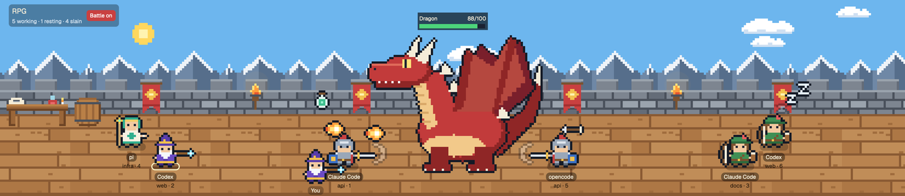
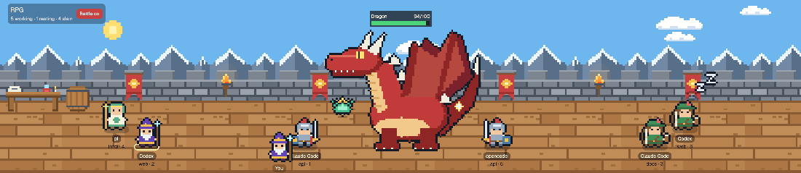

# RPG

A castle rampart across the top of the window, in pixel art, staffed by a small adventuring party. You and every agent are stubby, dark-outlined characters in one of four classes (wizard, healer, warrior, archer), and what each agent's character is doing shows that agent's status. Behind the battlements the sky runs a full day and night every 20 minutes, with drifting clouds. Below it are the tabs and terminals; the standard Spaces and Agents sidebar is on the left.

## What you see

- **Sidebar (left, 268px):** Herdr's own sidebar, unchanged: brand bar, Spaces, Agents, footer.
- **Scene (top of the rest, one third of the height, 230 to 560px):** a pixel-art scene at 4 screen pixels per art pixel. Back to front: a sky of night blue `#0b1230` with a tiled star field, a day-blue layer `#6db6ee` and five orange `#f2924e` horizon bands, each faded in and out by the time of day; a sun and a moon riding one circle half a turn apart and setting behind the wall; four clouds drifting left to right at 6 to 12 px/s, dimmer at night; a tiled snowy mountain range; 64px grey stone battlements with red banners and torches whose glow flickers and brightens at night; a 152px floor of tiled wooden planks with a table (scroll, potion, candle) and a barrel at the left. A dark tint lies over sky, wall and floor at night. A dark pill top-left reads "RPG" and a status summary.
- **You (72×72):** one of the four classes, picked at random the first time and remembered, labelled "You".
- **Agents (72×72):** one per agent, each a class picked at random when the agent first appears and remembered for that terminal. Each stands on a soft shadow with the program name and "space · tab" underneath, and a status bubble by its head.
- **Tab bar (42px) and terminals:** Herdr's `tabs` mod, then the active tab with each pane as a card (radius 10, 1px border, `pane` header 30px).
- **Theme `rpg`:** dark navy terminals (`#101c2c` on `#dbe7f3`), accent `#5cc8ff`.

## How it behaves

- **working:** the character bounces, and two pixel swords over its head swing together and apart with a spark flashing as they meet (native `loop` on `left` and `opacity`, 520ms).
- **blocked:** a red pixel speech bubble with a white "!" that hops (native `loop` on `top`).
- **done:** a green pixel speech bubble with a white tick, still.
- **idle:** the character stands still while three pixel z's of growing size drift up beside its head and take turns fading (native loops, 2.4s).
- The focused agent's shadow, and the one whose card is open, has a pale yellow ring.
- **Click empty space:** you walk there (4ms per px, clamped to the floor), alternating two walk frames every 160ms: a one-pixel lean each way with the other foot tucked up.
- **Click an agent:** a card opens above it, or beside it when there is no room: a 56px portrait (the sprite at 6px a pixel, cropped to the head), program, status and for how long, space and tab, terminal title, a "Go to terminal" button (`agent.focus`) and a close button. A small wrench in the portrait's top-right corner toggles a row of the four classes (the current one ringed); picking one changes the sprite, saves it and hides the row. Clicking the agent again closes the card.
- **Click yourself:** a smaller card with your portrait, class name and the same wrench.
- **Drag an agent:** after 4px of movement it becomes a dangling sprite that leans against the direction of travel. Releasing drops it; released over the wall, it falls to the floor.
- **Battle mode:** a button in the sign toggles it (red "Battle on" / grey "Battle off", saved; on by default). When on:
  - **Monster:** one stands in the middle of the floor, feet at floor y 108: a slime (136×104), an ogre (200×200) or a dragon (328×264), each with 100 HP and a name plate above it (name, `hp/100`, a 120px bar that is green above 50, yellow above 20, red below, its width eased over 400ms). Each is a still picture with pieces that move over or behind it on native `top` loops, so nothing shows through: the slime's dome (`-top`) sinks 8px into its foot (`-base`) and rises (1.7s); the dragon's tail (`-tail`) sways 5px behind its body (`-body`, 2.6s); the ogre and the dragon breathe, their upper body (`-top`: head, shoulders and arms, or head, neck and wings) rising 3px while the feet stay planted. Every 14 seconds the ogre shows its roar frame (`-2`) for 1.1s. All blink every 5.2s (an eyelid overlay for 170ms), and hop 4px when a blow lands.
  - **Formation:** every agent glides (700ms) from its own spot to a place computed from its class: warriors 44px outside the monster's bulk (the `half` width in its `core`, not the edge of its picture, so they stand under a dragon's head and tail) and just in front of it at floor y 114, everyone else 360px out from the picture's edge (five characters; less on a narrow scene), alternating left and right, each next one on a side 62px further out and staggered between floor y 96 and 60. Turning battle off glides them back. Agents cannot be dragged while in formation.
  - **Attacks:** every 3 seconds each working agent deals 1 HP and plays its attack in phases of 250ms each: wind-up, two of strike or flight, impact, then rest. Attackers do not move as one: each starts 0 to 4 phases (up to a second) into the beat, re-drawn from a hash of its address and the beat number, so the order changes every beat. Blows land around the middle of the monster's bulk (`core` in `MONSTERS`: an offset from its centre line and feet, and a radius), scattered by the same hash, so nothing flies through the empty corners of a big sprite. In formation every sprite is a 96×72 fighting pose facing the monster (`<class>-f|a1|a2-l|r.png`): stance, wind-up on phase 1, strike on phases 2 and 3. Warrior: raises its own sword, swings it level at full reach, and a white slash pops in at the tip and fades. Archer: draws with an arrow nocked, looses; the arrow flies to the monster in 500ms, then a spark. Wizard: raises its staff, thrusts it out; a fireball flies, then a burst. Healer (drawn mirrored so the free hand faces the monster): holds a potion up, flings its arm out; the potion is lobbed in an arc (up 44px for the first half of the flight, down for the second), then a green splash. Projectiles are hidden at the hand, shown only while flying, and slip back unseen. A working agent in formation shows no swords overhead and does not bounce.
  - **You:** when at least one agent is working you attack on the same beat for 1 HP, with the same poses and effects, facing the monster from wherever you stand. As a warrior you only attack (and only count) within 90px of the monster's bulk. While walking you use the walk frames.
  - **Defeat:** at 0 HP the monster fades out over 1.6s, the plate reads "<Name> slain!", the sign's count of the slain goes up, and after 9 seconds a different random monster appears.
  - The monster is hidden and everyone stays at their own spots when the scene is narrower than 640px.
- Whoever stands lower on the floor is drawn in front. Positions are remembered across restarts. New agents take the next free spot along the floor.

## Built from

- `layouts/rpg.json`: root `row` (`titlebar: none`, theme `rpg`) of `sidebar` (copied from Herdr's `main` layout: `workspace-chrome`, `spaces`, `agents`) and `office`, a `column` of `scene` (block, `rpg` mod, props `{ inset: 16 }`, weight 1) and `work` (weight 2: `tabs` block, then the `tab: active` block with the `pane` header mod).
- `mods/rpg/main.js`: one `View`. Props: `inset`, the sign's left edge in px (default 84 leaves room for macOS window buttons when the scene is in the top-left corner).
- `herdr` functions: `agents`, `spaces`, `shared` / `setShared` (key `rpg.state`: `{ you, spots, sprites, seen, battle, monster, slain }`), `props`, `run("agent.focus")`.
- gpui-kit: absolute positioning, `on_mouse_down` / `on_mouse_move` / `on_mouse_up` / `on_hover` on the root, `transition("left" | "top")` for walking and falling, `loop` and `frames` for the status animations, `cx.timer.after` to end the walk bob.
- `mods/rpg/art/`: scenery PNGs (`wall`, `floor`, `mountains`, `stars`, `sun`, `moon`, `cloud-a`, `cloud-b`, `banner`, `torch`, `table`, `barrel`, `wrench`), and per class `<class>.png`, `<class>-walk-{l,r}.png` and `<class>-rag-{c,l,r}.png` (dangling: straight, and sheared a few pixels each way). The class sprites are stubby 16×16 pixel art (big head, short body) with a one-pixel dark outline, on an 18×18 canvas so the outline fits. They are PNGs at 8 image pixels per sprite pixel (144px), drawn at 72px so each sprite pixel is 4×4 on screen and maps 1:1 on a retina display; the dangling frames are 22×22 (176px) drawn at 88px. SVG sprites rendered soft, so use PNG. Positions are rounded to whole pixels for the same reason.
- **Sky clock:** `cx.timer.every(10000)` in `init` stores `Date.now()` and re-renders; the time of day is `now % 20min`, so every window agrees. Opacities and the sun, moon and cloud positions glide with 10s linear transitions between ticks. A cloud that wraps gets a new element id so it does not glide back across the sky. `tools/rpg-sprites.py` in the repo draws every PNG.
- **Battle clock:** a second `cx.timer.every(3000)` in `init` counts working agents with `agents()` (plus you, if you can reach) and calls `fight(hits)`; on a hit it also starts a tick counter with nine `cx.timer.after` calls 250ms apart, each re-rendering once; every attacker's phase is that tick minus its own starting tick, so staggering costs no extra renders. Blinks and the ogre's roar are two more `cx.timer.every` timers that flip a flag on and off. Every motion inside a phase is a native transition (`left`/`top` for flight, `opacity` for impacts, with a 20ms fade-in and 350ms fade-out). The monster (`{ kind, hp, id, slainAt }`), the toggle and the kill count live in the shared state; HP is saved every 10 points and on a kill rather than on every hit. Monster art is drawn from ellipses and polygons, the fighting poses and attack art (`arrow`, `fireball`, `slash` in `-l`/`-r` pairs, `burst`, `potion`, `splash`) from pixel grids, all in `tools/rpg-sprites.py`.
- `themes/rpg.json`.

## Watch out

- The floor is a fixed 152px band placed with `bottom(0)`; everything on it is positioned in floor coordinates (feet position, y down from the top of the floor), so the room holds at any height. The wall height is learned from pointer events (`event.bounds`), not from `on_size_change`.
- There is no rotation in gpui-kit, so the ragdoll lean is three pre-drawn PNGs (straight, and sheared each way) chosen from smoothed pointer velocity.
- Child `on_mouse_down` handlers record the press; the root handles move and up. The root stops propagation so the layout never drags the window from the scene; do not set `window_drag` on the scene block.
- `herdr-app check` renders with no agents, so it does not exercise the agent, card or ragdoll code. Test those with a hard-coded fake agent.
- The app did not always hot-reload saves to the mod; switching layouts away and back reloads it.
- Agents share one free-form floor; with very many agents the default spots wrap into two rows and labels can overlap.

## Done when

- `herdr-app check mods/rpg` passes and `herdr-app status` shows no errors with the layout shown.
- With battle mode on and an agent working, the monster's HP drops by one per working agent every 3 seconds, and a new monster replaces a slain one.
- Each running agent appears as an adventurer with its program name, and its bubble matches its status.
- Clicking the floor walks you there; restarting the app keeps you there.
- Clicking an agent opens its card and "Go to terminal" focuses that agent's terminal.
- Picking a class in a card changes that character's sprite, and the choice survives a restart.
- Dragging an agent shows the dangling sprite and dropping it leaves it at that spot.
